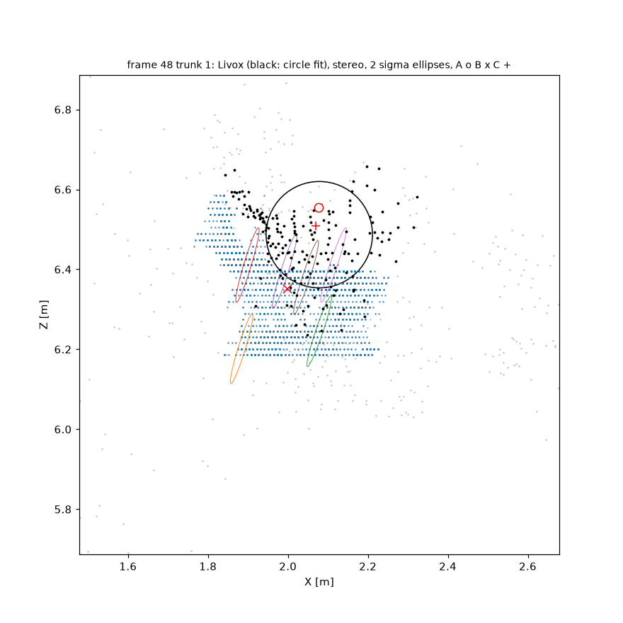
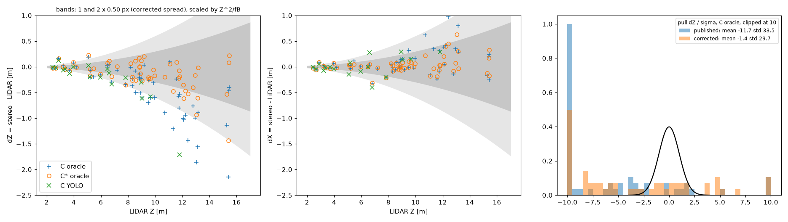

# stereo-trunk-lidar

This repository estimates 3D tree trunk centers from rectified stereo pairs and evaluates both the position
estimates and their analytical uncertainty bounds against synchronized 3D LiDAR.



*Frame 48, trunk 1, at 6.5 m. The blue points are the stereo pixels of the trunk, with 2-sigma ellipses along
their viewing rays. The black points are the Livox returns used for the ground truth circle, and the red markers
are the centers from estimators A (o), B (x) and C (+).*

## Summary

Below 5 m the trunk center is within 7 cm of the LiDAR in range and 5 cm laterally (RMSE over 8 trunks). Beyond
5 m every estimator reads short, with a median error of -0.20 m at 5-10 m and -0.92 m at 10-15 m. Most of this
comes from a disparity bias that depends on the image column and is consistent with an error in the published
stereo calibration. A correction fitted on 67 held-out frames brings the 10-15 m median down to -0.26 m.

On synthetic data whose noise follows the model, the spread of estimator C is within 4 % of its Cramér-Rao bound
from 3 to 15 m. On the real frames the predicted sigma of a trunk center is about 2 cm while the errors are
decimeters, so beyond 5 m the error is dominated by systematic error rather than by matching noise.

Detection is the weak part. A YOLO model trained on Finnish forest images finds 18 of the 56 trunks with ground
truth. Where it finds one, the position is as good as with the oracle mask.

## Data

The geometry comes from sequence 1018-00 of the [BotanicGarden](https://github.com/robot-pesg/BotanicGarden)
dataset (Liu et al., RA-L 2024): RGB stereo at 960x600 with a 0.254 m baseline, a Livox Avia, a VLP-16 and wheel
odometry, all triggered from one clock. I use 19 frames from the willow and poplar paths, with 80 trunks between
2.4 and 16 m, and 67 further frames from the same paths that are only used to fit the calibration correction.

The segmentation model is trained on [FinnWoodlands](https://github.com/juanb09111/FinnForest) (Lagos et al.,
SCIA 2023), a boreal forest dataset with trunk polygons. It ships without stereo or LiDAR calibration, so I don't
use it for geometry.

### Calibration checks

The 960x600 intrinsic files in the dataset leave a constant vertical offset of 0.75 px between the rectified
images (sub-pixel tracking, about 28,000 matches). Halving the 1920x1200 calibration brings the median residual
to 0.29 px, so I use that instead. After rectification f_x = 655.3 px, B = 0.2537 m and f_x*B = 166.3 px*m.

The camera fires 50.6 ms into each 100 ms Livox sweep. Every Livox point carries its own time stamp, so I keep
the whole sweep and move each point to the image instant using the wheel odometry (forward speed and yaw rate).
This reduces the depth drift across a sweep from 3.0 cm to 1.0 cm.

Comparing every Livox point with the SGBM disparity at its pixel (Z > 5 m) shows a bias of +1.31 px in columns
80-240, then +0.57, +0.30, +0.34, and +0.12 px in columns 720-880. Stereo reads short, and most on the left side
of the image. On smooth surfaces only, where the stereo disparity spans less than 1 px over a 9x9 window, the
trend is the same (+1.58 px on the left, +0.21 px on the right), so it is not an effect of depth edges or of the
LiDAR seeing past a trunk. The slope is what a mismatch of about 0.16 % in horizontal scale between the two
intrinsic calibrations would produce, and the constant part fits a relative yaw of about 0.9 mrad (0.05 deg)
between the cameras. The vertical rectification residual cannot show either, since both only move points along
the rows. It matters because $\partial Z / \partial d = Z^2 / (f_x B)$ is 0.87 m per pixel at 12 m.

The evaluation uses the published calibration. Separately, I fit

$$d_{stereo} - d_{lidar} = a + b\,(u - c_x) + c\,d_{lidar}$$

on the 67 held-out frames (576,009 points, iteratively reweighted least squares) and get a = +0.602 px,
b = -0.00159 and c = -0.0029. Rows marked with * in the tables below use this correction. The fit uses
full-scene LiDAR returns across 67 disjoint frames separated by at least 0.8 s from the evaluated frames.

## Pipeline

The three scripts are run in order.

`1_segment_and_disparity.py` reads the rosbag, rectifies the pair, computes SGBM disparity (block 5, 80
disparities, left-right check at 1 px), moves the Livox points into the rectified left frame at the image
instant, and runs YOLO11n-seg. It writes one folder per frame. It also contains a small fix for `rosbags` 0.11:
from byte 1,384,229,779 this bag writes its index record headers with the fields in the opposite order, and the
reader caches the offsets of the first record.

`2_estimate_trunks_3d.py` first runs a synthetic cylinder test, then estimates every trunk with three estimators
and writes `results/trunks.csv`.

`3_compare_lidar.py` fits the LiDAR ground truth and the held-out correction, then writes the table and the
figures.

### Masks

Each trunk has two masks. The oracle mask is a vertical band on the stem. Each band is seeded on a straight,
unoccluded stem segment, and its left and right sides are snapped to the bark edges from the image gradient (80
trunks kept across 19 frames after dropping forked or border-clipped stems). Because the band fixes a row range, the stereo pixels and the
LiDAR slice cover the same piece of stem, and a leaning trunk does not shift one against the other. The predicted
masks come from YOLO11n-seg trained on FinnWoodlands (80 epochs, mask mAP50 0.75 on its validation set).

Both masks are eroded by 3 px per side, half the SGBM block, and pixels more than 3 MAD from the median disparity
are dropped. Depth goes as 1/d, so a background pixel inside a trunk mask ends up meters behind the trunk and acts
as a gross outlier rather than as extra noise.

## Error model

A pixel (u, v) with disparity d in the rectified left frame (X right, Y down, Z forward) maps to

$$Z = \frac{f_x B}{d}, \qquad X = \frac{(u - c_x)\,B}{d}$$

With column noise $\sigma_u$ and disparity noise $\sigma_d$,

$$J = \frac{\partial(X, Z)}{\partial(u, d)} = \begin{bmatrix} B/d & -(u - c_x)B/d^2 \\ 0 & -f_x B/d^2 \end{bmatrix},
\qquad \Sigma_{XZ} = J\,\mathrm{diag}(\sigma_u^2, \sigma_d^2)\,J^\top, \qquad \sigma_Z = \frac{Z^2\sigma_d}{f_x B}$$

The ellipse lies along the viewing ray. With $\sigma_u = \sigma_d$ its axis ratio is $Z\sigma_d / (B\sigma_u)$,
about 40 at 10 m, which is why I report range and lateral error separately and never as one distance.

### Estimator A

The camera sees only the front of the trunk. For pixels evenly spaced across a cylinder of radius r, the median
surface depth is 0.866 r in front of the center. After erosion to a fraction a of the half-width, and for a trunk
seen at an angle $\theta$ off the optical axis,

$$Z_c = \frac{f_x B}{d_{med}} + r\sqrt{1 - a^2/4}\,\cos\theta, \qquad r = \frac{w\,Z_s\cos\theta}{2 f_x}$$

with w the mask width in pixels before erosion. I use the median because 1/d is monotone, so with symmetric
disparity noise the median depth is median-unbiased, while the mean depth is biased.

### Estimator B

Estimator B fits a free-radius RANSAC circle to the back-projected pixels. The arc only shows its curvature
through the sagitta $h = r(1 - \sqrt{1 - a^2})$, so once the per-pixel $\sigma_Z$ exceeds h the radius becomes
poorly observable. For r = 0.15 m, a = 0.8 and $\sigma_d$ = 0.5 px that is at about 4.5 m. Averaging over many
pixels delays the failure: in the synthetic test the radius is off by more than half in every run from 10 m on.
I keep B in the comparison to show where this breakdown occurs.

### Estimator C

Estimator C fixes the radius from A and fits the center $c = (X_c, Z_c)$ to every pixel's disparity along its own
ray. For column u the ray meets the circle at depth $Z_{hit}(u; c, r)$, so the model disparity is
$\hat d_i = f_x B / Z_{hit}$ and

$$\mathcal{L}(c) = \sum_i \frac{(d_i - \hat d_i(c))^2}{w_i}, \qquad w_i = \sigma_d^2 + \left(\frac{\partial \hat d_i}{\partial u}\right)^2 \sigma_u^2,
\qquad F = \sum_i \frac{G_i^\top G_i}{w_i}, \qquad \mathrm{Cov}(\hat c) \succeq F^{-1}$$

with $G_i = \partial \hat d_i / \partial c$. The weight $w_i$ is $\Sigma_{XZ}$ expressed in disparity. Here
$\sigma_u$ = 0.5 px stands for the uncertainty in which part of the bark a pixel's matching window sees. It only
matters near the trunk edges, where $\hat d$ changes quickly with u. For independent Gaussian noise $F^{-1}$ is the
Cramér-Rao bound on an unbiased estimate of c. The radius comes from A and is treated as exact, so the bound is
conditional on r and somewhat optimistic.

Levenberg-Marquardt starts from A, and $\sigma_d$ is re-estimated from the residuals of each trunk. A step is
accepted only if the weighted cost goes down and no more rays miss the circle. A ray that misses gets the depth of
its closest approach to the center, and without the second condition a distant trunk's fit can slide sideways
until a far circle mimics a tilted plane. The fit settles (last step below 0.1 mm) on 111 of the 112 masks.

My first version minimized the
radial residual $\lVert p_i - c \rVert - r$ of the back-projected points instead. On synthetic data it came out
14 to 23 cm short beyond 8 m: once $\sigma_Z$ exceeds r, noise across the radius lengthens every distance and the
fit pulls the center towards the camera. Fitting in disparity, where the noise actually lives, removes that bias.

### Correlated pixels

SGBM neighbors share their matching window and their aggregation paths, so N pixels carry far less information
than N independent measurements. I remove the per-column median residual, compute the residual autocorrelation
$\rho$ by FFT over lags up to +/-10 px, and use $N_{eff} = N / \sum \rho$. The predicted spread of C is
$F^{-1} N / N_{eff}$, plus one pixel of width in the radius. This is an approximation, not a Cramér-Rao bound: it
treats the correlation as a loss of sample size. On the real trunks N/N_eff has a median of 128.

### Synthetic test

The test renders a vertical cylinder with r = 0.15 m as an exact disparity image. Each pixel sees the surface at
a column off by $\sigma_u$ = 0.5 px, as the weights of C assume, and gets $\sigma_d$ = 0.5 px of white disparity
noise, or the same noise blurred by a 5x5 box (correlation area 25). Each row below is 200 runs, and script 2
prints this table every time it runs. Predicted is $F^{-1} N / N_{eff}$.

| Z_c [m] | noise | bias A [m] | bias C [m] | std C [mm] | CRLB [mm] | std C / CRLB | std C / predicted | N/N_eff | B radius off by > r/2 |
|---|---|---|---|---|---|---|---|---|---|
| 3  | white | -0.003 | -0.008 | 0.2   | 0.2  | 0.96 | 0.91 | 1.1  | 0 % |
| 5  | white | +0.001 | -0.005 | 1.3   | 1.2  | 1.02 | 0.95 | 1.2  | 0 % |
| 8  | white | +0.001 | -0.003 | 6.1   | 5.9  | 1.03 | 0.90 | 1.4  | 0 % |
| 10 | white | +0.010 | +0.005 | 12.0  | 12.0 | 1.00 | 0.85 | 1.5  | 100 % |
| 15 | white | -0.001 | -0.021 | 54.9  | 56.9 | 0.96 | 0.83 | 1.4  | 100 % |
| 3  | 5x5   | -0.003 | -0.008 | 1.3   | 0.2  | 5.39 | 1.16 | 21.9 | 0 % |
| 5  | 5x5   | +0.001 | -0.005 | 6.2   | 1.3  | 4.94 | 1.10 | 21.6 | 0 % |
| 8  | 5x5   | +0.003 | -0.006 | 27.3  | 5.9  | 4.60 | 1.15 | 19.9 | 6 % |
| 10 | 5x5   | +0.009 | +0.000 | 49.6  | 12.1 | 4.10 | 1.15 | 17.6 | 100 % |
| 15 | 5x5   | -0.013 | -0.035 | 197.8 | 51.3 | 3.86 | 1.47 | 9.2  | 100 % |

With white noise the spread of C is within 4 % of the Cramér-Rao bound from 3 to 15 m, which is about the
sampling error of a standard deviation from 200 runs. The bias of C is at most 2 cm, at 15 m. N/N_eff should be 1
there, but the estimate reads 1.1 to 1.5, so the predicted spread is 5 to 20 % too large. With correlated noise
the plain bound is 4 to 5 times too small. The N_eff correction brings the prediction within 16 % up to 10 m, but
on narrow, distant trunks the lag window no longer fits inside the trunk and the spread is 47 % above the
prediction at 15 m. B's radius fails in every run from 10 m on, and even at short range its algebraic refit
returns r ~ 0.10 m for a 0.15 m trunk.

## Results



*Left and center: range and lateral error of estimator C against LiDAR range, with the published calibration
(+), with the held-out correction (o), and with YOLO masks (x). The bands are 1 and 2 times 0.50 px of disparity
scaled by Z^2/(f_x B). Right: pulls dZ/sigma for C with oracle masks, clipped at +/-10, against N(0, 1).*

### Ground truth

For each trunk I take the Livox points inside its eroded oracle mask, split them into depth groups at gaps of
0.3 m and keep the largest group. Taking the nearest group instead would have picked up hanging willow branches
in front of several trunks. A circle with free radius is fitted to the group in the horizontal plane (algebraic
start, then geometric least squares), and the stereo radius is never used. 79 trunks have at least 8 points, and
59 of them have a radius between 0.03 and 0.6 m and a fit sigma in Z below 0.1 m. That sigma has a median of
1.1 cm (90th percentile 2.7 cm). The median LiDAR radius is 0.149 m and the median stereo radius 0.128 m. In the
15-30 m bin the median LiDAR radius is 0.28 m from only 4 trunks, so the ground truth there is doubtful.

One trunk (frame 168, trunk 3) has a wrong ground truth, because the largest group is an object at 5.8 m in front
of a trunk at 11.8 m. I keep it in the table and give the 5-10 m RMSE without it in brackets.

### Oracle masks

Each cell gives dZ = stereo - LiDAR in meters as median / RMSE. Rows marked * use the held-out disparity
correction.

| Estimator | 0-5 m (n = 8) | 5-10 m (n = 28) | 10-15 m (n = 16) | 15-30 m (n = 4) |
|---|---|---|---|---|
| A  | +0.00 / 0.07 | -0.20 / 1.20 (0.33) | -0.92 / 1.01 | -0.80 / 1.12 |
| B  | -0.05 / 0.08 | -0.33 / 1.24 (0.50) | -1.08 / 1.16 | -0.97 / 1.46 |
| C  | -0.01 / 0.07 | -0.23 / 1.21 (0.33) | -0.92 / 1.03 | -0.80 / 1.25 |
| A* | -0.01 / 0.07 | -0.04 / 1.37 (0.18) | -0.26 / 0.40 | -0.23 / 0.66 |
| C* | -0.02 / 0.07 | -0.05 / 1.37 (0.18) | -0.29 / 0.42 | -0.23 / 0.77 |

The lateral RMSE of C is 0.05 m below 5 m, and 0.51 m at 10-15 m with the published calibration, dropping to
0.25 m with the correction. B's radius is off by more than half for 1 of 8, 8 of 28, 9 of 16 and 3 of 4 trunks in
the four range bins.

### YOLO masks

A predicted mask is assigned to the oracle trunk it covers most, provided it covers at least half of it. I don't
use IoU here because the oracle masks are short bands while the predicted masks cover whole stems. The model
covers 18 of the 56 trunks with ground truth. It finds most of the willows and almost none of the poplars.

| Estimator | 0-5 m (n = 7) | 5-10 m (n = 10) | 10-15 m (n = 1) |
|---|---|---|---|
| A  | -0.00 / 0.06 | -0.21 / 0.31 | -1.45 |
| C  | -0.02 / 0.07 | -0.21 / 0.33 | -1.71 |
| A* | -0.01 / 0.06 | -0.15 / 0.17 | -1.19 |
| C* | -0.03 / 0.08 | -0.17 / 0.17 | -1.45 |

Where the model does find a trunk, the position is as good as with the oracle mask. With these masks the cost of
segmentation shows up as missed trunks, while the accuracy on the trunks it finds is unchanged.

### Discussion

A and C differ by a median of 1.5 cm in range per trunk (2.5 cm in the horizontal plane). All pixels of one trunk
sit at nearly the same depth and get
nearly the same weight, so the full likelihood changes the center very little. What C adds is the bound and the
ellipses.

The pulls of C have mean -11.7 and std 33.5 with the published calibration, and mean -1.4 and std 29.7 with the
correction. The correction removes most of the shift but not the width. The predicted sigma of a trunk center has
a median of 1.9 cm, of which the bound $F^{-1}$ alone gives 1.6 mm; the rest is the correlation of the pixels. The
remaining errors are still decimeters at long range, so a three-parameter model does not capture all of the
systematic error, and the noise model by design says nothing about bias.

The effective disparity error of a trunk center, taken from the spread of dZ * f_x B / Z^2, is 0.59 px with the
published calibration and 0.50 px with the correction. The median per-pixel residual sigma_d is 0.18 px.

## Limitations

The stereo disparity has a bias that depends on the image column, consistent with an error in the published
calibration, and it dominates every result beyond 5 m. I have not separated the scale and yaw parts, and the
three-parameter correction leaves decimeter errors.

The Cramér-Rao bound of C treats the radius from A as exact. On one mask Levenberg-Marquardt stops at its
iteration limit with a last step of 2 mm.

The ground truth in the 15-30 m bin rests on 4 trunks with a median LiDAR radius twice the stereo one.

One trunk gets an object in front of it as ground truth. The Livox also sits 0.15 m to the right of the camera,
so background it sees past a trunk's right edge projects inside the camera's mask. The erosion removes most of
these points.

The left 80 columns of the image have no disparity, and 5 of the 80 oracle trunks give no estimate.

SGBM disparities come in 1/16 px steps, which shows up as rows of points in the bird's eye view (pixel locking).

N/N_eff ranges from 15 to 377 and is underestimated on narrow trunks.

The cylinder model assumes a vertical trunk. The trunk in the bird's eye view leans, and its LiDAR points spread
out in X.

YOLO was trained on birch, spruce and pine in Finland and misses most of the poplars in Shanghai.

## Reproduce

```
pip install -r requirements.txt
python 1_segment_and_disparity.py   # needs data/bgarden/1018_00_VLIO.bag, the calibration files and data/yolo/trunk.pt
python 2_estimate_trunks_3d.py      # synthetic test, then the trunks; about 2 minutes
python 3_compare_lidar.py           # table and figures in results/
```

Script 1 expects the BotanicGarden calibration under `data/bgarden/calib/` and the YOLO weights under
`data/yolo/`. The weights come from training `yolo11n-seg.pt` on FinnWoodlands with the classes Tree, Spruce,
Birch and Pine merged into one class (80 epochs, image size 1024). The oracle masks go in
`frames/NNNN/mask_oracle.png`; if one is missing, script 1 opens a polygon tool for that frame. Neither the frames
nor the weights are in the repository.

`results/` holds the outputs of the last run: `trunks.csv` (one row per mask with the estimator outputs),
`table.txt`, and the two figures.

## Credits and licenses

- BotanicGarden: Liu et al., *BotanicGarden: A High-Quality Dataset for Robot Navigation in Unstructured Natural
  Environments*, IEEE RA-L 2024. Academic use only; no frames from it are redistributed here.
- FinnWoodlands: Lagos, Lempiö and Rahtu, *FinnWoodlands Dataset*, SCIA 2023.
- The segmentation step uses [ultralytics](https://github.com/ultralytics/ultralytics), which is AGPL-3.0.
